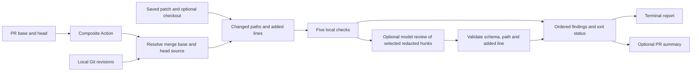

# Guardrail

Guardrail reviews Python changes locally, turns acceptance criteria into pytest scaffolds, and evaluates three versioned prompts against their example outputs. Its GitHub Action can publish the review on a pull request.

## Fresh-clone quick start

Start in the root of a fresh clone with Git and Python 3.12 installed. Create and activate a virtual environment using the commands for your shell.

**Windows PowerShell**

~~~powershell
py -3.12 -m venv .venv
.\.venv\Scripts\Activate.ps1
~~~

If the Windows launcher cannot resolve `-3.12`, run `py -0p` and use the full 3.12 interpreter path from its output, for example `& "C:\path to Python 3.12\python.exe" -m venv .venv`. Activate the resulting environment as above.

**Linux**

~~~sh
python3.12 -m venv .venv
. .venv/bin/activate
~~~

The remaining commands work in either shell. Install the development extra from the repository root. The tests exercise the provider with a local subprocess fixture. Installation needs access to the dependencies. The walkthrough itself uses bundled data and requires no API credentials.

~~~sh
python -m pip install -e ".[dev]"
guardrail --version
~~~

Each example starts with the same quantity defaults module. Use two new sibling directories so each patch has its own matching post-change source. Stay in the repository root throughout.

~~~sh
cp -r examples/offline/checkout "../guardrail clean"
cp examples/offline/clean/changes.patch "../guardrail clean/changes.patch"
git -C "../guardrail clean" init -q
git -C "../guardrail clean" apply changes.patch
guardrail review --diff "../guardrail clean/changes.patch" --source-root "../guardrail clean" --no-llm
~~~

The clean patch prints `No findings.` and exits **0**. [Expected clean report](examples/offline/clean/expected.txt)

~~~sh
cp -r examples/offline/checkout "../guardrail defective"
cp examples/offline/defective/changes.patch "../guardrail defective/changes.patch"
git -C "../guardrail defective" init -q
git -C "../guardrail defective" apply changes.patch
guardrail review --diff "../guardrail defective/changes.patch" --source-root "../guardrail defective" --no-llm
~~~

The defective patch imports a missing name at `quantities.py:1` and silently swallows an exception at `quantities.py:7`. Both are warnings. The default threshold gives exit **1**. Read the status immediately with `$LASTEXITCODE` in PowerShell or `echo $?` in a POSIX shell. Replay the recorded terminal session with `asciinema play docs/cli-demo.cast`. [Expected defective report](examples/offline/defective/expected.txt) · [Recorded CLI demo](docs/cli-demo.cast)

Replay the three prompt contracts and run the project's test suite.

~~~sh
guardrail prompts eval --offline
python -m pytest
~~~

Each replay should report `"passed": true`. Pytest runs the unit, patch, CLI, snapshot, prompt-contract and fake-provider tests and fails below 85% statement coverage of the `guardrail` package. The Windows and Linux CI jobs also build a wheel, install it in a second empty environment, and exercise the CLI, prompt fixtures and scaffold template outside the checkout. Run that packaging check locally with `python scripts/smoke_wheel.py`. [Quality workflow](.github/workflows/quality.yml) · [AI-assisted changes and verification](docs/AI_USAGE.md)

Continue the walkthrough by turning the bundled shipment story into two runnable tests, or try the same reviewer on a pull request. [Story-to-scaffold example](#generate-pytest-scaffolds) · [Consumer Action workflow](#review-pull-requests-with-github-actions)

On Linux with unprivileged user and network namespaces enabled, repeat the review from either prepared checkout with networking disabled.

~~~sh
unshare --user --map-root-user --net guardrail review --diff changes.patch --no-llm
~~~

## How a review works

| Check | Reports | Source needed |
| --- | --- | --- |
| `imports` | Unresolved imports and missing names in simple local modules | Whole files and installed dependency metadata |
| `exception-handling` | Bare handlers and broad handlers that discard errors | Whole Python files, Ruff and Bandit |
| `secrets` | Credential-shaped strings and high-entropy credential assignments | Added text lines |
| `test-reference` | New functions or methods with no plausible reference in tests | Whole source and tests |
| `no-test-changes` | Executable Python changes with no test-file changes | Patch; whole source improves classification |

### Measured benchmark

In the recorded offline run, Guardrail caught **17 of 27 targets (63.0%)** and flagged **0 of 10 clean patches**. Mean review time was **0.232 seconds per patch** with **$0 model cost**. The ten misses were boundary and missing-None defects. Model-assisted measurements await a live run. [Dataset and scoring rules](benchmarks/README.md)

Run `guardrail benchmark score benchmarks/results/run.json` to reproduce the published results. The [benchmark report](benchmarks/results/summary.md) records recall, clean PRs with false alarms, elapsed time, model cost and live-run status.

## Choose the source for a review

From a Git checkout, compare a feature branch with its base.

~~~sh
guardrail review --base main --head HEAD
~~~

Guardrail diffs the merge base against the specified head commit. It reads complete Python files, including unchanged tests, from that same commit. You can run the command with another branch checked out or with local edits.

To save the same comparison and review it later, write the patch directly with Git. Run the review from the matching post-change checkout, or select it with `--source-root`.

~~~sh
git diff --full-index --output=changes.patch main...HEAD
guardrail review --diff changes.patch
guardrail review --diff changes.patch --source-root "/path/to/feature checkout"
~~~

Saved-patch mode uses working-tree contents. It checks Git post-change blob IDs when present and checks hunk text at the recorded new-file lines. For a plain unified diff, content outside the hunks and files absent from the patch must come from the checkout you selected. The Python source set includes tracked files and non-ignored untracked files.

When only the patch is available, run this from any directory.

~~~sh
guardrail review --diff changes.patch --patch-only
~~~

The report gives the changed-file and added-line counts. If the checkout is missing, disagrees with the patch, or provides too little evidence to verify a post-change file, the report marks whole-file checks as skipped and gives the reason. For example, a deletion-only patch identifies no surviving file to match. A malformed patch or invalid revision produces an input error and exits with status 3.

## Review findings and exit status

The report lists findings by repository-relative file and, when available, 1-based line in the post-change file. Each entry includes the check name, severity, message, and a suggestion when supplied.

The built-in `imports` check inspects added Python imports, including aliases, relative imports, and names added to multiline imports. It searches the reviewed source at the repository root and under `src/`, recognizes standard-library names, and uses the review environment's installed distribution metadata for third-party import names. Install the project's dependencies in that environment for the most accurate results.

An unresolved module or a missing name in a simple local module produces a warning. The check leaves external package contents and dynamic exports (such as a module-level `__getattr__` or a wildcard re-export) unverified. It reads source without importing reviewed modules. Patch-only reviews skip this check.

The `exception-handling` check warns on added bare `except` clauses and broad handlers that swallow unexpected errors, such as `except Exception: pass` or a silent fallback return. It combines Ruff (E722, BLE001) and Bandit (B110, B112) into one warning per affected handler, anchored on an added line. A narrowly handled expected error or a typed handler that logs and re-raises stays quiet. Both scanners run locally against the selected post-change source. Patch-only reviews skip the check. A scanner failure reports the tool and exits with status 3.

The `secrets` check runs on added lines in every text file, including in patch-only reviews. It reports one blocking finding per line containing a recognizable GitHub token, AWS access key ID, Slack token, Stripe key, or high-entropy literal assigned to a credential-like name such as `API_KEY` or `password`. The assignment heuristic looks for at least 16 characters and 3.5 bits of Shannon entropy per character. It skips ordinary UUIDs and leaves checksums in checksum fields alone. Findings give the location. Review output and prepared model excerpts mask detected values as `[REDACTED]`, including repeated values in hunk context and removed lines.

### Test-related warnings

- `test-reference` checks each new Python function or method outside test files, including async definitions. It searches the complete head revision's tests (or the matching checkout's tests) for a loaded name, attribute, or explicit import matching the function's name. An unchanged test can satisfy the check. The reference heuristic can match another function with the same name or miss an indirect call. The warning points to the new definition. Patch-only reviews skip this check.
- `no-test-changes` emits one warning for the entire patch when executable Python logic changes without any test-file change. An unrelated test edit clears this warning. Comments, docstrings, and documentation files alone produce no warning. The location is the first added logic line in patch order. If the patch only removes logic, the report shows the first affected file without a line number, using the former path for a deleted file. This check also runs in patch-only mode, where classification is limited to the context present in the hunks.

Both checks recognize Python files under a `test/` or `tests/` directory and files named `test_*.py`, `*_test.py`, `tests.py`, or `conftest.py`.

### Exit thresholds

Use `--fail-on blocking` (the default) or `--fail-on warning` with either review input mode.

| Review outcome | `--fail-on blocking` | `--fail-on warning` |
| --- | ---: | ---: |
| No findings or informational findings only | 0 | 0 |
| Warning is the highest severity | 1 | 2 |
| At least one blocking finding | 2 | 2 |
| Review input or check execution failed, including invalid check output | 3 | 3 |

Operational diagnostics go to standard error. A partial review applies the same thresholds to findings from the checks that ran.

## Review pull requests with GitHub Actions

In a consumer repository, save this workflow as `.github/workflows/guardrail.yml`. Replace `FULL_COMMIT_SHA` with a trusted commit of this project containing `action.yml`.

~~~yaml
name: Guardrail PR review
on: pull_request
permissions:
  contents: read
  pull-requests: write
concurrency:
  group: guardrail-pr-${{ github.event.pull_request.number }}
  cancel-in-progress: true
jobs:
  review:
    runs-on: ubuntu-latest
    steps:
      - uses: piyushtiwary/AI-Code-Review-Guardrail-Prompt-Library@FULL_COMMIT_SHA
        with:
          comment: 'true'
~~~

The action installs Guardrail from the selected action revision. It fetches both event SHAs and their history into a temporary bare Git repository. This project's own workflow loads the action from the PR base commit, so it can review subsequent PRs once the action is present on the base branch. [Repository workflow](.github/workflows/guardrail.yml)

| Input | Default | Effect |
| --- | --- | --- |
| `fail-on` | `blocking` | Warnings below the threshold produce a job warning and pass. Set to `warning` to fail on warnings too. Blocking findings and operational errors fail the job. |
| `use-llm` | `false` | Set to `true` on a runner with an installed, authenticated Codex CLI to enable live review of same-repository PRs. The default hosted workflow runs offline. Fork PRs always use local checks. |
| `comment` | `false` | Set to `true` to post the summary and refresh it on reruns, including after a clean push. |

For log-only reviews, omit `comment` and grant only `contents: read`. When commenting is enabled, the CLI prints the report first. If GitHub denies the comment with HTTP 403, the log records the limitation and the review keeps its normal exit status. This supports the default read-only workflow token on fork PRs.

To rehearse the consumer workflow, put it on the consumer's base branch, then open a same-repository PR containing the changes from the defective example against its bundled base. Open the **Guardrail PR review** check and the bot's **Guardrail review** comment. With the default threshold, expect a green job and warnings at lines 1 and 7. Replace the PR's changed files with the clean example and push again. The same comment should update to `No findings.` The local sample PR exercised both revisions and captured the comment before and after the update. [Sample PR summary](docs/sample-pr-summary.md)

To publish from a CLI workflow step, set `GITHUB_TOKEN` to `${{ github.token }}` and pass the PR number to `guardrail review`.

~~~sh
guardrail review --base "$BASE_SHA" --head "$HEAD_SHA" --comment-on-pr "$PR_NUMBER"
~~~

Supply the event's base SHA, head SHA, and PR number as step environment variables. The CLI reads the destination from `GITHUB_REPOSITORY` or `--repository OWNER/REPO`. It updates a PR conversation comment only when its first line carries Guardrail's marker and GitHub identifies its author as `github-actions[bot]`. The per-PR concurrency group serializes publishers.

## Optional model review

Install the native Codex CLI and sign in once with `codex --no-daemon login`. Check `codex --no-daemon login status`, then use one of the commands below. Guardrail starts the local executable for each eligible request. Codex sends that request to the model service using its own authentication. Live review requires network access and an account with access to `gpt-6-sol`. [Codex authentication](https://developers.openai.com/codex/auth/)

On Windows, Guardrail checks `%LOCALAPPDATA%\Programs\OpenAI\Codex\bin\codex.exe`. It also supports a native executable on PATH. To select a different installation, set `GUARDRAIL_CODEX_BIN` to its absolute executable path. The adapter was tested with Codex CLI 0.172.0.

~~~sh
guardrail review --base main --head HEAD --use-llm
guardrail review --diff changes.patch --patch-only --use-llm
~~~

Local checks run first. A Python hunk qualifies when a local finding points to one of its added lines, or when it contains at least 12 nonblank, non-comment added lines. The second rule uses hunk size as a proxy for complexity. With no eligible hunks, the CLI skips the provider. The default and explicit `--no-llm` modes run offline, including when credentials are present.

Guardrail starts at most one Codex process per review. It uses the instructions from `diff-edge-case-review` version `1.0.0` and supplies the selected, redacted hunks as user input. In patch order it includes whole hunks that fit within a combined 16 KiB UTF-8 budget for instructions and input. It skips hunks with masked paths or unencodable text. Python launches `codex --no-daemon -a never exec` with `--model gpt-6-sol` and `model_reasoning_effort="medium"`. It sends data through UTF-8 stdin in a temporary working directory. The session is ephemeral and read-only, with shell tools and web search disabled. Guardrail enforces a 120-second deadline and a 64 KiB limit on the final answer. Benchmark token counts come from the completed-turn event. [Non-interactive Codex](https://developers.openai.com/codex/noninteractive/), [Configuration reference](https://developers.openai.com/codex/config-reference/)

The CLI validates each returned finding independently. A model finding must use the prompt's check ID and match an exact path and added line from the submitted hunks. Accepted findings participate in the usual exit threshold. Omitted eligible hunks, rejected findings, malformed responses, and provider failures mark model review incomplete in the report. Local findings and their exit thresholds still apply.

## Parse acceptance criteria

`guardrail.story.parse_story(text)` accepts a Jira issue heading such as `SHIP-42: Reroute a shipment` or a `Story: <title>` heading. Start each scenario with `Scenario: <name>`, then write its `Given`, `When`, and `Then` clauses in order. Use `And` to continue the preceding clause type. The parser returns each scenario’s conditions, actions, and outcomes in input order. [Shipment rerouting example](stories/reroute.feature)

Misplaced clauses raise `StoryInputError` with the offending line number. If a scenario ends before a required clause, the error names the missing clause and points to the scenario heading.

## Generate pytest scaffolds

The shipment story asks a dispatcher to reroute a late shipment and keep an on-time shipment on its original route. From the repository root, select a new temporary output directory. In PowerShell run `$scaffold = Join-Path ([IO.Path]::GetTempPath()) ([guid]::NewGuid().ToString())`. In a POSIX shell run `scaffold=$(mktemp -d)`. Then run the same three commands in either shell.

~~~sh
guardrail storygen stories/reroute.feature --out "$scaffold"
python -m pytest --no-cov --collect-only -q "$scaffold/test_reroute.py"
python -m pytest --no-cov -q "$scaffold/test_reroute.py"
~~~

Collection lists `test_a_shipment_has_breached_its_sla` and `test_a_shipment_is_on_time` and exits **0**. Running them gives **2 failed**, exit **1**. Each test preserves its scenario's wording as Arrange, Act and Assert comments and stops at `pytest.fail("TODO: implement this scenario")`. Replace each TODO with a call to the shipment code and assertions on the route and notification before moving it into your own suite.

If the destination file already exists, generation exits with status 3 and preserves the file. To compare scaffolds after updating a story, generate into a fresh output directory.

## Render a versioned prompt

After installation, run any of these commands from any directory. Each prints the prompt with its packaged example inputs filled in and requires no credentials.

~~~sh
guardrail prompts render diff-edge-case-review 1.0.0 last-seat
guardrail prompts render endpoint-pytest-scaffold 1.0.0 lookup
guardrail prompts render write-acceptance-criteria 1.0.0 booking-capacity
~~~

To supply your own inputs in Python, select a prompt by its ID and exact version. For diff review, supply redacted hunks in the format returned by `ReviewSource.prepare_model_hunk`.

~~~python
from guardrail.prompts import load_prompts

entry = load_prompts()["write-acceptance-criteria", "1.0.0"]
text = entry.prompt.render({
    "title": "Cancel a booking",
    "requirements": "Confirmed booking: cancelling it releases the reserved seats.",
})
~~~

The [prompt library](src/guardrail/prompt_library) stores each template, its input names, expected output properties, known failure modes, and evaluation history in a versioned YAML file. Each example points to a fixture containing inputs, a hand-written reference output, and separate scoring expectations. When revising a released prompt, add a new semantic version and corresponding fixtures.

## Evaluate the prompt library

`guardrail prompts eval` replays the packaged reference outputs offline. The version 1.0.0 histories record a passing replay for each of the three fixtures. To save the per-example JSON results, redirect standard output.

~~~sh
guardrail prompts eval --offline > replay-results.json
~~~

| Example | What a pass checks |
| --- | --- |
| `last-seat` | Every item is a valid review finding with the prompt's check ID. The paths and line numbers match the expected anchors exactly, including their counts. |
| `lookup` | The module compiles and imports pytest. Each request has a distinct, parameterless top-level test with Arrange, Act and Assert comments, its expected HTTP response, and a final `pytest.fail("TODO: implement this scenario")`. Guardrail inspects the source without executing it. |
| `booking-capacity` | The story title matches, the required scenarios appear in order, and each has nonempty Given, When and Then clauses in order. |

To evaluate fresh responses, sign in to Codex as described under **Optional model review**. Live mode sends one rendered prompt per example and applies the same checks.

~~~sh
guardrail prompts eval --live > live-results.json
~~~

Each record identifies the prompt, version, fixture and example, mode, verdict, and reason. Live records also include the provider, configured model, and UTC evaluation date. Exit status **0** means all examples passed, **1** means an output failed its contract, and **3** means a configuration, library, or provider error prevented a complete evaluation.
